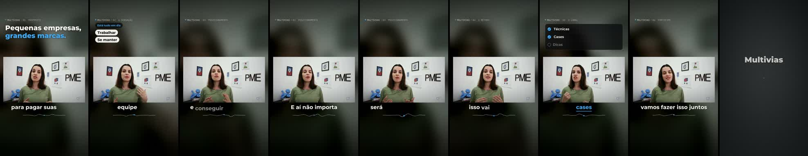
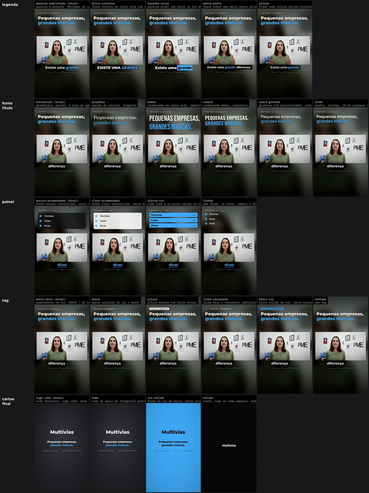
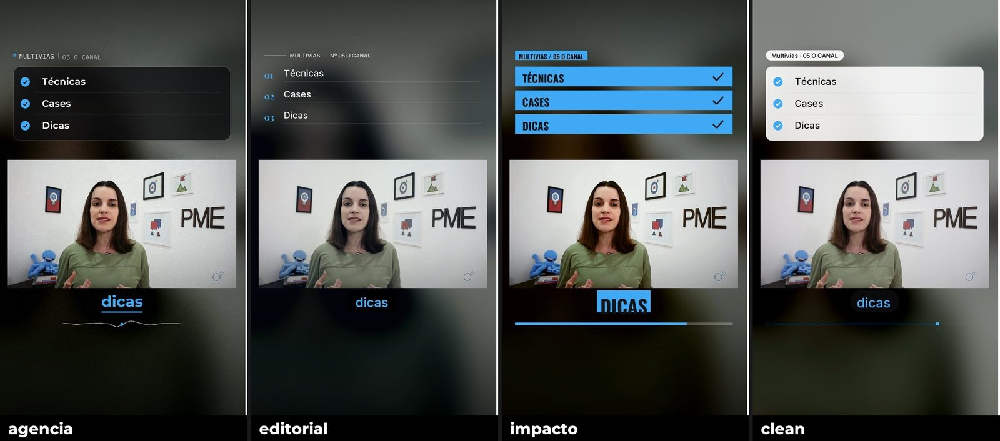

# CyborgCut

**The agent edits the video from the script.** You hand over the raw takes and the text of what
the video must say; the agent reads both, picks the right stretch of each take by word, drops
b-roll on the word it illustrates, draws per-chapter graphics, captions word by word, adds a music
bed and an end card, and checks the result before showing it to you.

[Versão em português](README.md)

It is an [Agent Skill](https://agentskills.io): works in Claude Code, Codex, Gemini CLI and any
agent that reads `SKILL.md`. Python and ffmpeg only. No Remotion, no Node, no API keys.



*A 16:9 channel video (CC BY) turned into a reel: the picture in a box, graphics above, captions below. The plan that produced it is [`demo/plano.json`](demo/plano.json).*

## What it does that the others don't

Existing video skills start from the take: cut silence, drop fillers, burn captions. CyborgCut
starts from the **script**. The difference shows up when the speaker recorded five attempts, when
the script asks for "shot of the store open" over a sentence, when there is on-screen text and an
enumeration that should become a checklist. It is the work an agency does, not what a silence
cutter does.

| | Silence cutter | CyborgCut |
|---|---|---|
| Input | one take | script + several takes + b-roll |
| Cut | removes pauses | picks the stretch by word, tightens breaths measured on audio |
| B-roll | manual | on the word it illustrates |
| Graphics | none or generic | title, checklist, counter, steps, waves, button, per chapter |
| QA | none | re-transcribes, scans for black frames and flashes, measures loudness |

## Try it without coding

You need an Apple Silicon Mac (2020 or newer) or a Windows PC, and the Claude app on a paid plan
(Pro or Max).

1. Get the app at [claude.ai/download](https://claude.ai/download), sign in and open the **Code** tab.
2. Make a folder for the video with two things in it: a folder named `bruto` with the clips as they
   came off the camera, and the script in whatever form you have it (doc, PDF, plain text).
3. In Claude, pick that folder and paste:

   > Install the skill from GitHub raphael-cyborg/cyborgcut so I can use it in any folder, set up my
   > computer for it, and edit the video in this folder following the script. Before the final
   > render, show me the style mural so I can pick the look.

The first time it installs a few tools and downloads the speech model (2 to 3 GB), and it will ask
you to approve some steps. On a Mac, if a tool is missing, it may ask you to paste one command into
Terminal and type your computer password once. After that, each new video is just the folder and the
sentence. The video never leaves your computer: speech is transcribed locally, and Claude only reads
the text and a few thumbnails to decide the cuts.

## Install

Any agent (goes to `~/.claude/skills/`, `.codex/skills/`, …):

```bash
npx skills add raphael-cyborg/cyborgcut
```

No Node (no `npx`): download the [zip](https://github.com/raphael-cyborg/cyborgcut/archive/refs/heads/main.zip)
and unpack it as `~/.claude/skills/cyborgcut/`.

Claude Code as a plugin:

```bash
claude plugin marketplace add raphael-cyborg/cyborgcut
claude plugin install cyborgcut@cyborgcut
```

Then, inside the skill folder, the Python environment:

```bash
uv venv && uv pip install -e ".[mac]"      # Apple Silicon Mac
uv venv && uv pip install -e ".[cpu]"      # Linux, Windows, Intel Mac
python scripts/cyborgcut.py doctor         # tells you what is missing
```

Needs `ffmpeg` 5+ (`brew install ffmpeg` · `apt install ffmpeg` · on Windows, the **full** build
from [gyan.dev](https://www.gyan.dev/ffmpeg/builds/)). Transcription runs locally (mlx-whisper
on Mac, faster-whisper elsewhere); the model downloads on first use.

## Use

One folder per video:

```
my-video/
  bruto/        the footage, as it came from the phone
  roteiro.md    what the video must say
  logo.png      optional
```

Then ask the agent:

> edit the video in `my-video/` following the script, agency style

The agent runs `preparar` (color, clean voice, transcription, footage catalog), reads the script
and the transcripts, writes a word-anchored `plano.json`, renders previews, looks at them, renders
and checks. You get `saida/<title>.mp4` and `saida/conferencia.md`.

The skill files are in Portuguese (its first audience is Brazilian agencies); the agent answers in
your language. [`SKILL.md`](SKILL.md) is the agent's manual, [`references/plano.md`](references/plano.md)
the plan format, [`references/pecas.md`](references/pecas.md) the graphics catalog.

## The style belongs to the client, not to the tool

No two clients should get the same look. The visual is assembled from an arsenal: 17 variables
(title font, captions, panel, corner tag, signature, b-roll transition, camera, entrances, color
finish, end card, sound…), each with options. The agent draws every option **on a frame of the
actual video** and the person picks by looking; the combination is saved under the client's name
and replicated on every video after that.



```bash
python scripts/cyborgcut.py estilo mural demo                       # every option, on the project's own frame
python scripts/cyborgcut.py estilo variacoes demo --n 8             # eight full random combinations to point at
python scripts/cyborgcut.py estilo salvar demo acme --set legenda=karaoke-caixa --set fonte_titulo=oswald
```

Then it is just `"estilo": "acme"` in the plan. Five starting points ship with it: `agencia`,
`editorial`, `impacto`, `clean`, `limpo`.



Variables and options: [`references/estilo.md`](references/estilo.md) (Portuguese; the option
names are the ones the CLI prints).

## Under the hood

1. **Color**: phone HDR converted (Apple `avconvert` on Mac, `zscale` on Linux and Windows).
2. **Voice**: RNNoise removes room noise; level is set before compression; -14 LUFS at the end.
3. **Cut**: each spoken stretch runs from one word to another, with edges at the silence valley
   between words and breaths tightened, all measured on audio.
4. **Captions and anchors**: the assembled voice is transcribed again; that is where times come from.
5. **Picture**: two layers (speaker, b-roll) cut per frame; slow push-in camera; graphics drawn in
   Python frame by frame.
6. **QA**: per-sentence re-transcription, black-frame and single-frame-flash scan, loudness.

Details and the reason behind each choice: [`references/tecnicas.md`](references/tecnicas.md).

## Demo

`demo/` is a complete project: an 87 s Portuguese video (CC BY, credits below), the script
reconstructed from the speech, and the plan the agent wrote.

```bash
bash demo/baixar.sh
python scripts/cyborgcut.py preparar demo
python scripts/cyborgcut.py montar demo
python scripts/cyborgcut.py montar demo --estilo impacto     # same plan, different look
python scripts/cyborgcut.py conferir demo
```

## Machine

Tested on a 16 GB M4 Mac. Render with motion and finish: 4 to 5 s of machine time per second of video. The
scripts cap ffmpeg at 4 threads and wait if another render is running: two videos at once on
16 GB freeze the machine. Linux and Windows pass CI on a small fixture; real-machine reports welcome.

## Licenses

- Code: MIT.
- Montserrat, IBM Plex Mono, Playfair Display, Oswald, Bebas Neue, Space Grotesk and Inter fonts: SIL Open Font License (`assets/fontes/`).
- RNNoise `sh` model: public domain ([GregorR/rnnoise-models](https://github.com/GregorR/rnnoise-models)).
- Music beds `lofi-calma` ("Walking Away") and `groove-leve` ("Make Funk"): HoliznaCC0, CC0 1.0.
- Demo footage: "Pequenas Empresas podem se tornar Grandes Marcas", Multiviascom, YouTube,
  Creative Commons Attribution (not in the repo; the script downloads it).

## Author

[Raphael Martins](https://instagram.com/raphael.cyborg), Synapse Sales. Born from a real test:
editing the same ad an agency team edited, from the same footage and the same script, side by side.
